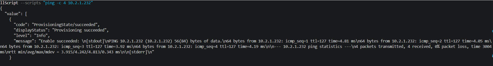

# Cross-Cloud VPN Connectivity Test & Troubleshooting Writeup

## Objective

Establish a working Site-to-Site VPN tunnel between an AWS VPC and an Azure
VNet, using static routing, and prove real bidirectional connectivity with
actual traffic — not just a "Connected" status on either side.

---

## Architecture

| | AWS | Azure |
|---|---|---|
| CIDR | `10.2.0.0/16` | `10.3.0.0/16` |
| IaC tool | Terraform | Bicep |
| Gateway | VPN Gateway + Customer Gateway | VPN Gateway (`VpnGw1AZ`) + Local Network Gateway |
| Routing | Static (via `aws_vpn_connection_route` + route propagation) | Static (via a dedicated route table on the test subnet) |
| Test resource | EC2 instance, SSM-managed, no inbound access | Azure VM, managed via `az vm run-command`, no inbound access |

Both test resources were deliberately built with **no inbound management
access at all** — SSM on the AWS side, Run Command on the Azure side — to
keep the architecture consistent with the "private by default" approach used
throughout this portfolio's other projects.

---

## What Went Right, Quickly

Both sides' core IaC — VPC/VNet, subnets, gateways, the VPN connection
objects themselves — deployed without major issues once a handful of
platform-specific gotchas were worked through (see below). The real
challenge wasn't writing the Terraform or Bicep; it was getting the tunnel
to actually negotiate.

---

## Platform-Specific Issues Hit Along the Way

These aren't failures — they're exactly the kind of real-world friction a
cross-cloud project is supposed to surface, and each one taught something
concrete about how the two platforms differ:

- **Azure security group / NSG description character restrictions** — AWS
  security group rule descriptions reject certain characters (apostrophes
  included) via a strict allow-list regex. A minor but very literal
  reminder that cloud APIs enforce character-set restrictions that aren't
  always obvious until a deploy fails on them.
- **Azure VPN Gateway SKU deprecation** — `VpnGw1` (non-availability-zone)
  SKUs are no longer accepted for new VPN Gateway deployments; only the
  `VpnGw1AZ`-class SKUs are. This isn't caught by Bicep's static validation
  — it only surfaces as a runtime deployment failure, meaning the schema
  still technically accepts the old SKU name even though the platform
  rejects it at creation time.
- **`Standard_B1s` capacity shortage in `eastus`** — a real, live capacity
  restriction at the time of deployment, not a configuration error. Checking
  `az vm list-skus --location eastus --all false` showed no B-series sizes
  available in the region at all at that moment, resolved by switching to a
  `Standard_D2as_v4` instead.
- **Azure's full nested resource-reference requirement for connection
  objects** — `virtualNetworkGateway1` and `localNetworkGateway2` inside a
  `Microsoft.Network/connections` resource require an embedded (even if
  empty) `properties: {}` object alongside the `id` reference, not just a
  bare `{ id: ... }`. Bicep's own compiler flags this as a possible type
  definition inaccuracy, suggesting it's a known rough edge in how the
  resource schema was modeled.

---

## The Real Problem: Zero Traffic, No Errors

After both sides deployed successfully, the VPN connection reported
`NotConnected` on Azure and `DOWN` on both AWS tunnels, with:

- A correct, matching pre-shared key on both sides
- A correct Azure Local Network Gateway IP
- `IKEv2` explicitly configured
- No BGP accidentally enabled
- **Zero bytes transferred in either direction, with no error messages
  anywhere in either cloud's logs or telemetry**

This absence of any error text was itself the key diagnostic signal: a
genuine IKE parameter mismatch (wrong encryption algorithm, mismatched DH
group, etc.) would typically produce *some* failed-negotiation evidence —
packets sent, rejected, logged. Zero bytes transferred, with nothing logged
on either side, pointed toward a more fundamental issue: one side wasn't
even attempting to reach the other at all.

### Root Cause

The AWS `aws_customer_gateway` resource — which tells AWS where to find
Azure's VPN endpoint — had been created early in the project with a
**placeholder IP address** (`203.0.113.1`, a reserved documentation-range
address), before Azure's real VPN Gateway existed. After Azure's gateway
was deployed and its real public IP was known, **the Customer Gateway was
never updated** to reflect it.

This was confirmed directly:

```
aws ec2 describe-customer-gateways
  → IpAddress: 203.0.113.1   (the placeholder, still in place)
```

AWS had been configured this entire time to expect an IKE handshake from an
address that would never send one, while Azure was correctly configured
and attempting to reach AWS's real address the whole time. Both sides were
individually "correct" in isolation — the mismatch only existed in the
relationship between them, which is exactly why neither side's own
diagnostics flagged an error: each side genuinely believed its own
configuration was valid.

### The Fix

Updating `ip_address` on an `aws_customer_gateway` resource forces Terraform
to destroy and recreate it (an in-place IP update isn't supported), which in
turn forces recreation of the dependent VPN Connection — and because AWS
generates pre-shared keys automatically per-connection, **this also produced
new PSKs for both tunnels**, requiring Azure's Local Network Gateway and
Connection resources to be redeployed with the updated tunnel IP and new
shared key.

After this update and redeployment, the tunnel came up and stayed up
immediately:

```
Azure: connectionStatus = Connected
AWS tunnel 1 (18.204.75.174): Status = UP
```

---

## Proof of Connectivity

A tunnel reporting "Connected" with zero bytes transferred isn't sufficient
proof of a working cross-cloud network — it only confirms the IKE/IPsec
negotiation succeeded, not that routed application traffic can actually
cross it. To prove real connectivity, a ping was issued from the Azure VM
(`10.3.1.4`) to the AWS EC2 instance (`10.2.1.232`), using Azure's
`az vm run-command invoke` (no inbound access to the VM was ever opened):

```
PING 10.2.1.232 (10.2.1.232) 56(84) bytes of data.
64 bytes from 10.2.1.232: icmp_seq=1 ttl=127 time=4.81 ms
64 bytes from 10.2.1.232: icmp_seq=2 ttl=127 time=4.05 ms
64 bytes from 10.2.1.232: icmp_seq=3 ttl=127 time=3.92 ms
64 bytes from 10.2.1.232: icmp_seq=4 ttl=127 time=4.19 ms

--- 10.2.1.232 ping statistics ---
4 packets transmitted, 4 received, 0% packet loss, time 3004ms
rtt min/avg/max/mdev = 3.915/4.242/4.813/0.343 ms
```

Zero packet loss, consistent round-trip latency (~4ms), across a real
IPsec tunnel spanning two independent cloud providers.



---

## Key Takeaways

1. **"Connected" status and zero bytes transferred is not proof of a
   working tunnel** — it only confirms negotiation succeeded, not that
   routed traffic can actually pass. Always validate with real traffic.
2. **A placeholder value left unfixed after its dependency is resolved is a
   realistic, easy-to-make mistake** — not a contrived failure. Any project
   with a chicken-and-egg resource dependency (needing cloud B's output
   before cloud A's config can be finalized) has to guard against exactly
   this.
3. **Absence of errors can itself be diagnostic information.** A silent,
   zero-byte, no-error failure pointed away from a parameter mismatch and
   toward "one side isn't trying to reach the other at all," which was the
   correct direction to investigate.
4. **Changing identity-defining values on networking resources (like a
   Customer Gateway's IP) often forces full resource replacement**, with
   downstream consequences (new PSKs) that have to be propagated to the
   other cloud — a real operational implication worth planning for, not
   just a Terraform technicality.